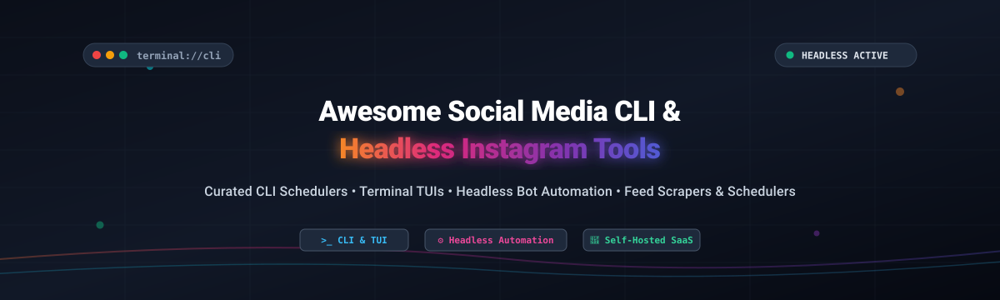

  

# 🚀 Awesome Social Media CLI & Headless Instagram Tools 📸

  
  
  
  
  
  

---

## 🎯 Top Social Media CLI & Headless Instagram Tools Ecosystem

**Curated List of SaaS/Hosted Platforms & Open-Source GitHub Projects**  
*Focused on Terminal Instagram Clients, Headless Social Automation, CLI Schedulers, Feed Archivers & Self-Hosted Publishers*  

📅 **Last updated: November 2026**

This repository is an SEO-optimized, community-curated directory tracking the best **SaaS/hosted social media management platforms** and high-performance **open-source GitHub projects** for **Social Media CLI & Headless Instagram Tools**. Whether you are an indie hacker, Python developer, DevOps engineer, terminal enthusiast, or social media agency, these tools empower you to automate Instagram workflows, manage DMs, auto-schedule posts/reels, scrape metadata, and monitor multi-network channels directly from terminal environments and headless microservices without GUI bloat.

🔥 **Notable Examples & Key Tools**:
- **Terminal & TUI Clients**: `supreme-gg-gg/instagram-cli`, `toot`, `tut`, `tuisky`, `chafa`, `timg`
- **Headless SDKs & Automation Libraries**: `instagrapi`, `instagram-private-api`, `Playwright`, `Crawlee`, `FFmpeg`
- **Media Downloaders & Feed Bridges**: `Instaloader`, `yt-dlp`, `gallery-dl`, `RSSHub`, `newsboat`
- **Self-Hosted AI Schedulers**: `Postiz`, `Mixpost`, `n8n`
- **Enterprise & SaaS Platforms**: `Buffer`, `Hootsuite`, `Later`, `Sprout Social`, `Planoly`, `Tailwind`, `Loomly`, `SocialPilot`, `Sendible`, `Metricool`

💡 **Open-Source & Terminal Emphasis**: This list heavily highlights active open-source command-line interfaces, headless GraphQL/private REST API wrappers, cron-ready schedulers, and decentralized social protocols (AT Protocol, Nostr, ActivityPub) — perfect for building lightweight, keyboard-centric, distraction-free social pipelines.

---

## 📑 Table of Contents

- [📊 Sector Overview & Market Dynamics](#-sector-overview--market-dynamics)
- [☁️ SaaS/Hosted Platforms](#️-saashosted-platforms)
- [💻 Open-Source GitHub Projects](#-open-source-github-projects)
- [🤝 How to Contribute](#-how-to-contribute)
- [💖 Support & Sponsorship](#-support--sponsorship)
- [📈 Star History](#-star-history)
- [⚠️ Disclaimer](#️-disclaimer)

---

## 📊 Sector Overview & Market Dynamics

The global social media management software market is estimated at approximately **$23B – $35B in 2026**, projected to surpass **$100B+** over the next decade at a CAGR of 16%–23%. The sector exhibits a hybrid competitive structure: heavily concentrated at the enterprise tier dominated by consolidated giants like Sprout Social and Hootsuite offering unified governance, while remaining structurally fragmented across SMBs and creator segments where dozens of niche schedulers, point tools, and open-source headless alternatives compete fiercely.

---

## ☁️ SaaS/Hosted Platforms

| Platform | 🏢 Revenue / Valuation (Company Size) | 💳 Pricing (Starting Tier) | 🎁 Free Tier Limit / Trial Duration & Limits | ⚡ Key Highlights |
| :--- | :--- | :--- | :--- | :--- |
| **[Sprout Social](https://sproutsocial.com)** | ~$491M ARR / ~$660M Market Cap | $199/seat/month (Standard tier, billed annually) | 30-day free trial (no credit card required; access to 5 social profiles, standard publishing & analytics) | Enterprise social listening, multi-profile publishing, automated approval queues, and deep CRM integrations. |
| **[Hootsuite](https://hootsuite.com)** | ~$350M–$400M ARR / ~$1B+ peak valuation | $99/month (Standard plan, 1 user, 10 social profiles) | 14-day free trial (full features across selected tier, capped at 10–20 daily posts per org during trial) | Enterprise scheduling, cross-channel dashboard, team workflows, and brand monitoring. |
| **[Later](https://later.com)** | ~$50M–$75M ARR (Est., MavSocial/Later PE) | $18.75/month (Starter tier billed annually, or $25 billed monthly) | Free-forever plan: 1 user, 1 social set, 10 scheduled posts/month total, basic Linkin.bio | Visual drag-and-drop Instagram feed planner, hashtag suggestions, and Linkin.bio builder. |
| **[Buffer](https://buffer.com)** | ~$30M–$37M ARR / Profitable private SaaS | $6/channel/month (Essentials tier, or $5/channel/mo billed annually) | Free-forever plan: up to 3 channels, 1 user, 10 scheduled posts per channel at any one time | Clean minimalist social scheduling, Instagram first-comment queuing, and straightforward per-channel billing. |
| **[SocialPilot](https://socialpilot.co)** | ~$15M–$25M ARR / Profitable bootstrapped | $25.50/month (Essentials tier billed annually, or $30 billed monthly; 7 social accounts, 1 user) | 14-day free trial (no credit card required; full access to 7 social profiles, scheduling, and analytics) | Agency-oriented multi-account social queueing, white-label reporting, and client management. |
| **[Metricool](https://metricool.com)** | ~$12M–$20M ARR / Bootstrapped & profitable | $20/month (Starter tier, or $15/mo billed annually for 1 brand with 50 social profiles) | Free-forever plan: 1 brand (up to 1 profile per platform except X & LinkedIn), 20 posts/month, 30-day analytics | Detailed competitor analysis, multi-platform publishing, and interactive bio-link generator. |
| **[Planoly](https://planoly.com)** | ~$10M–$15M ARR / Private VC-backed | $14/month (Starter plan billed annually, or $16 billed monthly; 1 social profile, 1 user) | Free-forever plan: 1 user, 1 social profile, 10 scheduled posts/uploads per month (or 14-day free trial on paid tiers) | Visual grid planner designed for visual content creators across Instagram, TikTok, and Pinterest. |
| **[Tailwind](https://tailwindapp.com)** | ~$8M–$15M ARR / Private SaaS | $14.99/month (Base standalone monthly tier, or $9.99/mo billed annually) | Free trial plan: one-time non-resetting allowance of 10 scheduled Pins/posts and 5 keyword searches (no credit card required) | AI ghostwriter, automated smart scheduling intervals, and visual design tools tailored for Instagram and Pinterest. |
| **[Sendible](https://sendible.com)** | ~$8M–$12M ARR (Part of Trajectory / Performa PE) | $29.75/month (Core tier billed annually, or $35 billed monthly; 1 workspace, 6 social profiles) | 14-day free trial (no credit card required; access to 1 workspace, 6 profiles, and scheduled posting) | Digital marketing agency platform with unified social inboxes, client approval workflows, and automated RSS posting. |
| **[Loomly](https://loomly.com)** | ~$5M–$8M ARR / Private (Trajectory PE) | $32/month (Base tier billed annually, or $42 billed monthly; 2 users, 10 social accounts) | 7-day free trial (no credit card required; full access to collaborative calendars, post ideas, and automated posting) | Collaborative editorial calendar, post mockup previews, asset library, and approval workflows. |

---

## 💻 Open-Source GitHub Projects

- **[n8n](https://github.com/n8n-io/n8n)**   
  Fair-code workflow automation platform with CLI execution support for headless social scheduling & APIs.

- **[yt-dlp](https://github.com/yt-dlp/yt-dlp)**   
  Command-line audio/video downloader supporting Instagram Reels, Stories, IGTV, and video platforms.

- **[Playwright](https://github.com/microsoft/playwright)**   
  Headless browser automation framework for reliable end-to-end web testing and social scraping.

- **[FFmpeg](https://github.com/FFmpeg/FFmpeg)**   
  Complete, cross-platform solution to record, convert, format aspect ratios (9:16 Reels), and stream audio/video.

- **[RSSHub](https://github.com/DIYgod/RSSHub)**   
  Extensible RSS feed generator that generates web feeds from Instagram profiles, posts, and social platforms.

- **[Postiz](https://github.com/gitroomhq/postiz-app)**   
  AI-powered social media scheduling tool with API/CLI access and self-hosted web UI across multiple networks.

- **[Crawlee](https://github.com/apify/crawlee)**   
  Web scraping and browser automation library for Node.js to build headless social extractors with proxy rotation.

- **[gallery-dl](https://github.com/mikf/gallery-dl)**   
  CLI media and metadata downloader for Instagram, X, Reddit, Bluesky, Pinterest, and image hosting sites.

- **[Instaloader](https://github.com/instaloader/instaloader)**   
  Python CLI and library to download public and private Instagram profiles, hashtags, stories, and highlights.

- **[Nostr Protocol](https://github.com/nostr-protocol/nostr)**   
  Censorship-resistant decentralized social networking protocol with numerous lightweight CLI/TUI clients.

- **[AT Protocol (Bluesky)](https://github.com/bluesky-social/atproto)**   
  Social networking technology created by Bluesky for decentralized public social media applications.

- **[instagrapi](https://github.com/subzeroid/instagrapi)**   
  Fast, effective headless Python library for Instagram Private Mobile API with uploads, DMs, and insights.

- **[instagram-private-api](https://github.com/dilame/instagram-private-api)**   
  Headless Node.js/TypeScript SDK for Instagram private mobile API automation and bots.

- **[chafa](https://github.com/hpjansson/chafa)**   
  Terminal graphics and character art generator to render photos and preview social posts inside the console.

- **[LinkStack](https://github.com/LinkStackOrg/LinkStack)**   
  Self-hosted open-source Linktree and bio link alternative for Instagram profile landing pages.

- **[Mixpost](https://github.com/inovector/mixpost)**   
  Self-hosted social media management platform (Buffer/Hootsuite alternative) built with Laravel & Vue.

- **[newsboat](https://github.com/newsboat/newsboat)**   
  Fast RSS/Atom feed reader for text terminals, perfect for consuming RSSHub social feed bridges.

- **[timg](https://github.com/hzeller/timg)**   
  Terminal image and video viewer using high-resolution terminal graphics (Kitty, Sixel, Unicode blocks).

- **[instagram-cli](https://github.com/supreme-gg-gg/instagram-cli)**   
  Terminal UI & CLI client for Instagram to browse feeds, view stories, and chat via Direct Messages.

- **[indigo](https://github.com/bluesky-social/indigo)**   
  Go implementation of the Bluesky AT Protocol for building custom terminal bots and relays.

- **[toot](https://github.com/ihabunek/toot)**   
  CLI and TUI client for Mastodon and the Fediverse enabling shell-based posting and timeline reading.

- **[tut](https://github.com/RasmusLindroth/tut)**   
  TUI client for Mastodon with vim-inspired keyboard shortcuts.

- **[tuisky](https://github.com/sugyan/tuisky)**   
  Terminal User Interface (TUI) client for Bluesky written in Rust.

🛠️ **Frameworks for building custom systems**: Combine **instagram-cli** for interactive terminal DMs and feed browsing with **instagrapi** + **FFmpeg** + **cron** for automated headless Reel/post publishing, or self-host **Postiz** / **Mixpost** for visual team calendars.

---

## 🤝 How to Contribute

1. 🍴 Fork the repository.
2. 📝 Add or edit entries in `README.md` (follow the table/list structure).
3. 🔍 Include: tool name, direct link, concise factual description, and Stars_Counts/pricing details where applicable.
4. 🚀 Submit a Pull Request with a clear explanation of your additions.

⭐ **Star the repo** if you find this curated collection useful for your automation workflow!

---

## 💖 Support & Sponsorship

Thank you so much for exploring and using this collection! Maintaining and curating open-source resources takes continuous research and effort. 

If this repository saved you time, helped your development workflow, or introduced you to your favorite headless/CLI tool:
- ⭐ **Star this repository** to help others discover it.
- 🍴 **Fork and contribute** to keep the list fresh and accurate.
- 📢 **Share** with your friends, colleagues, and developer communities.
- ☕ **Buy me a coffee & support my open-source work**: Sponsor via the [GitHub Sponsors Dashboard](https://github.com/sponsors/ishandutta2007).

Your support is deeply appreciated and keeps projects like this actively maintained!

---

## 📈 Star History

---

## ⚠️ Disclaimer

- This is a **community-curated** list — not exhaustive and not an official Meta endorsement.
- Headless clients and CLI wrappers that automate private Instagram endpoints (`instagram-cli`, `instagrapi`) can trigger rate limits, security checkpoints, or account restrictions if abused; use realistic delays, persistent session files, and dedicated accounts.
- Never commit session cookies, 2FA seeds, or Instagram passwords into public Git repositories; store credentials in OS keychains or restricted `.env` files.

---

  <b>Made with ❤️ for terminal enthusiasts, automation engineers, indie creators, and open-source developers.</b> 
  <i>Let's make social media CLI tools and headless workflows faster, distraction-free, and open to everyone.</i>

